  

  

<i>Walk, hit the signs, and get to know me!</i>

---

### 👋 Hi, I'm Athari

Data Science student at **Umm Al-Qura University** (Class of 2028). I enjoy turning raw, messy data into clear insights: cleaning it, exploring it, and building machine learning models on top of it.

Currently looking for a **co-op training** opportunity.

### 🛠 Skills

`Python` · `SQL` · `pandas` · `scikit-learn` · `Machine Learning` · `Data Preprocessing` · `Data Warehousing` · `Flask` · `SQLite` · `Jupyter`

### 📂 Projects

| Project | About |
|---|---|
| [Disability Services Gap](https://github.com/athari19/fajwa-disability-services-gap) | Hackathon analysis of disability services in Saudi Arabia using public data |
| [Heart Disease Prediction](https://github.com/athari19/heart-disease-prediction) | Logistic Regression & Random Forest (group project; I wrote the code and the evaluation) |
| [Social Media Addiction Analysis](https://github.com/athari19/social-media-addiction-analysis) | Full preprocessing pipeline on a 705-student survey (group project) |
| [Saudi Art Museum Database](https://github.com/athari19/Saudi-Art-Museum-Database) | Relational database design: ER diagram, schema and SQL (group project) |
| [PageTurn Library](https://github.com/athari19/Pageturn-library) | Flask + SQLite book-borrowing web app (group project) |

### 📫 Contact

[LinkedIn](https://www.linkedin.com/in/athari-althomali-a12142363) · athari.althomali@gmail.com
